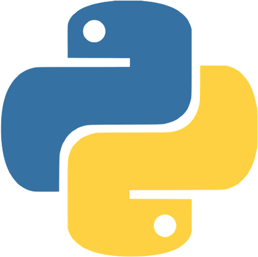
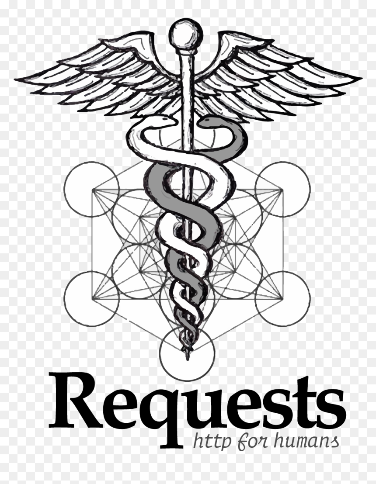
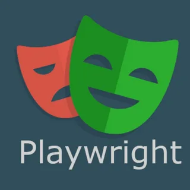
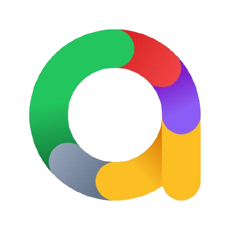
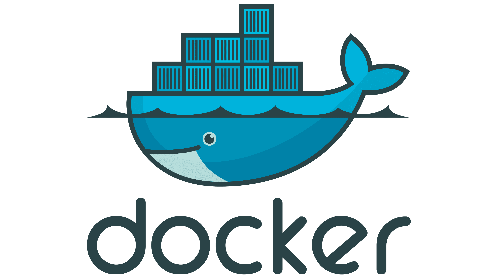
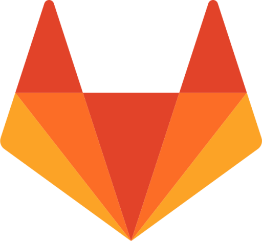
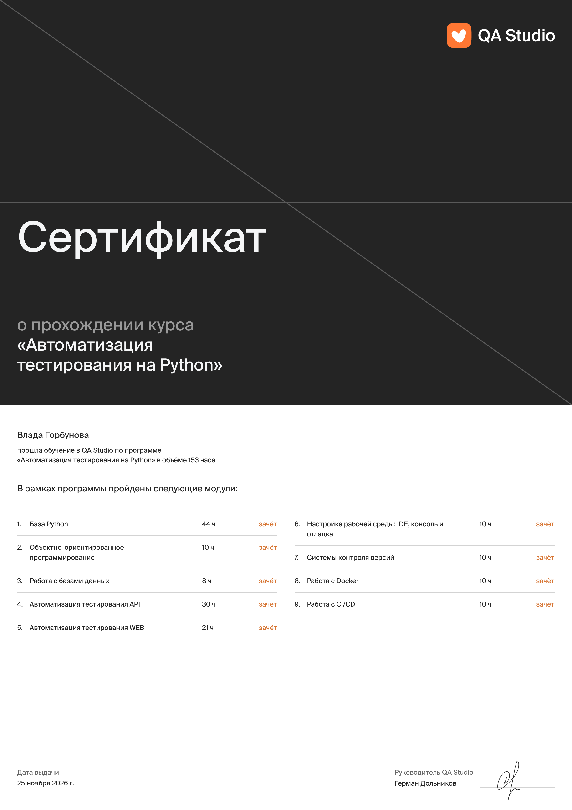

## Всем привет, я Влада 👋
##### Fullstack Middle QA🧡

* 🔥 2,5 года в тестировании
* 🐍 Пишу автотесты на Python
* ⚙️ Развиваюсь в автоматизации
* 📑 Опыт и навыки в **[резюме](https://tyumen.hh.ru/resume/ad650039ff09864b410039ed1f716245396855?hhtmFrom=profile)**
* 📞 Мои контакты: **[телеграм](https://t.me/lokroskos)**, **[почта](gorbunova_vlada@inbox.ru)**

  

### Python QA Auto

#### Мой стек:
| Python | PyCharm | Git | Pytest | Requests | Playwright | Allure Report | Docker | Gitlab CI |
|--------|---------|-----|--------|----------|----------|---------------|--------|-----------|
|   |   || |  | | | | |

#### Мои проекты:
| API My Shows Rating |  API Битва покемонов | UI Битва покемонов |
|---------------------|----------------------|--------------------|
|[my-shows-api-tests](https://github.com/VladislavaVG/myshows_api_tests)|[pokemonbattle-api-tests](https://github.com/VladislavaVG/pokemonbattle_api_tests)   | [pokemonbattle-e2e-tests](https://github.com/VladislavaVG/pokemonbattle_e2e_tests_playwright)   
| Pytest, Requests, Docker|Pytest, Requests, Gitlab CI| Playwright, Gitlab CI|

### 📚 Обучение
||
